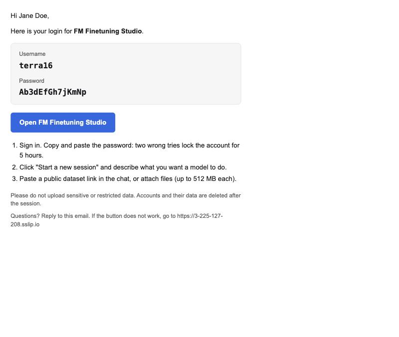
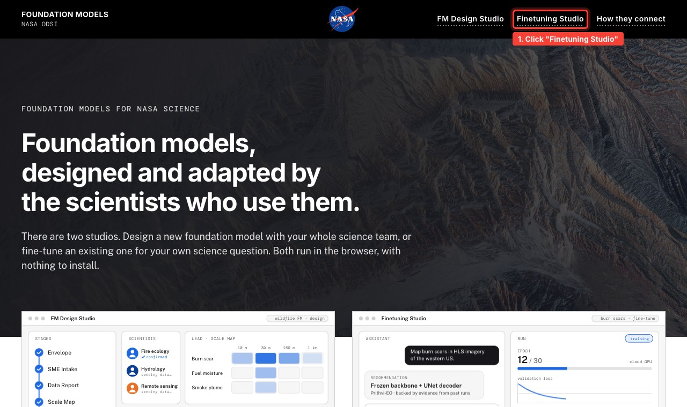
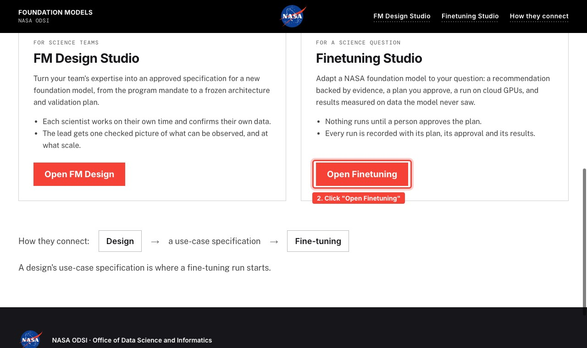
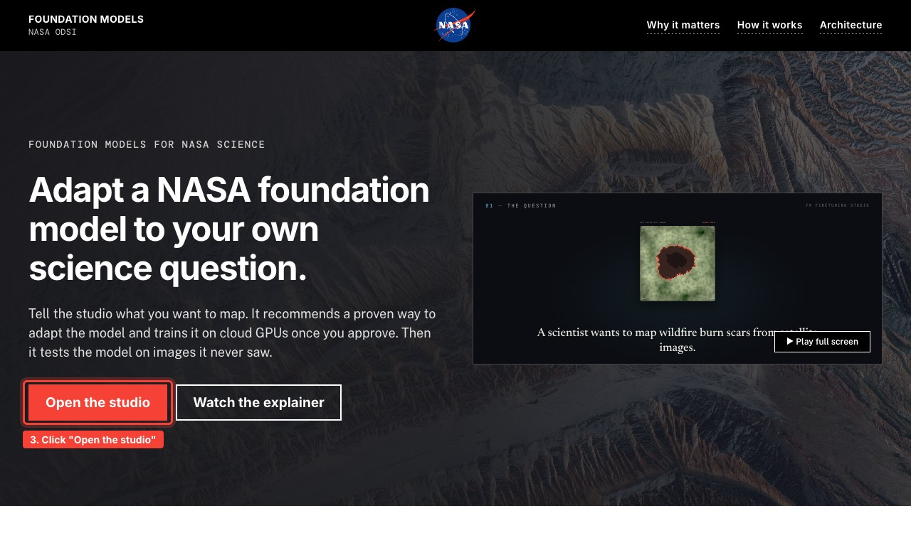
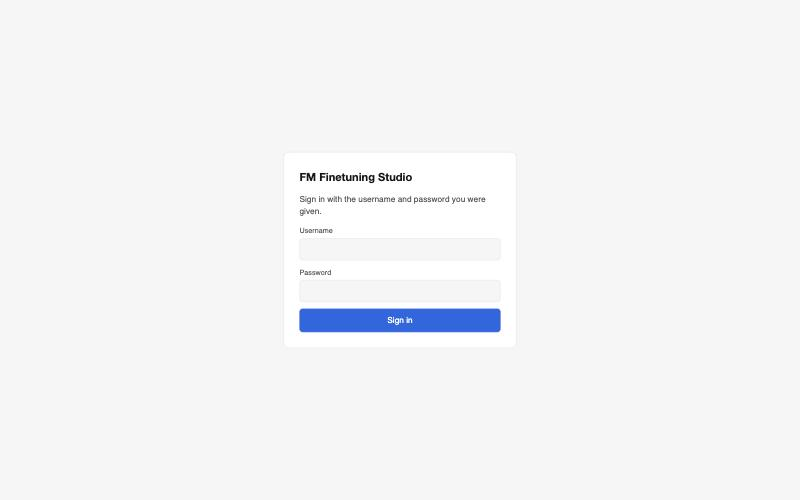
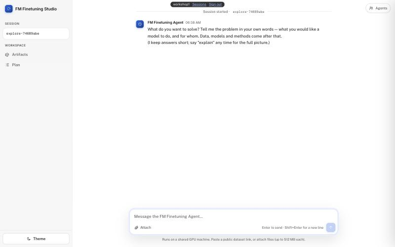

# FM Finetuning Studio: hands-on session

FM Finetuning Studio is a chat in your browser. You describe a problem in your own words,
point it at your data, and a team of agents works with you to check the data, choose a
foundation model (Prithvi-EO or Prithvi WxC), plan a fine-tuning experiment and run it on a
shared GPU machine.

Worked examples to follow are in [examples/](examples/).

## 1. Before the session

1. **Sign up** with the form you were sent. Within a minute or two you get an email,
   "Your FM Finetuning Studio login", with your username and password.
   No email? Check spam and quarantine (NASA mail filters can hold it), then ask an
   organiser.
2. **Bring**
   - one sentence: what you would like a model to do, and for whom;
   - your data, as a public link (see [Bringing your data](#4-bringing-your-data)).

## 2. Sign in

1. Open the studio, any of these ways:
   - from NASA's Foundation Models page: **https://fm.akd.odsi.io** → **Finetuning Studio**
     → **Open Finetuning** → **Open the studio**;
   - or go to **https://fm-finetuning.akd.odsi.io** and click **Open the studio**;
   - or click **Open FM Finetuning Studio** in your login email (it goes straight to
     https://3-225-127-208.sslip.io).

   From **https://fm.akd.odsi.io**, click what is marked in red:

   

   

   

2. Enter your username and password. **Copy and paste the password**: two wrong tries lock
   the account for 5 hours (an organiser can unlock it).
3. The **Sessions** page opens:
   - **Open chat** goes back to the chat you have open;
   - **Start a new session** starts a fresh chat;
   - **Resume** reopens an earlier session with its files.

## 3. The chat page

| Part | What it does |
|---|---|
| Left sidebar | your session id; **Artifacts** (every page the agents wrote, and **Download all**); **Plan** (where things stand); **Theme** (light or dark) |
| Top bar | your username, **Sessions** (switch or start sessions), **Sign out** |
| **Agents** (top right) | which agents are working right now, and what they did |
| Message box | type and press Enter; Shift+Enter for a new line |
| **Attach** | upload files, or add a link to a paper, dataset card or web page |
| **Stop** | appears while the agents work; stops the current step (files are kept) |

### How a session goes

The agents ask one question at a time. Answer in your own words; say **"explain"** at any
point for the full picture.

1. **Problem**: what the model should do, and for whom.
2. **Data**: a link or files; the agents take a quick look.
3. **Data check**: read-only scripts measure the data (sizes, bands, labels, splits) and
   write a report.
4. **Plan**: a ranked list of experiments that fit your data; you pick one.
5. **Run**: a short fine-tuning run on the shared GPU; the score is measured on held-out
   data the model never saw.
6. **Report**: a written report of what was done and what it means.

## 4. Bringing your data

Paste a **public link** in the chat: a Hugging Face dataset, a GitHub folder, an `s3://`
open-data path, or a direct URL to a file, `.zip` or `.tar.gz`. The chat takes a sample of
up to 500 files / 2 GB and unpacks archives.

Private datasets (that need a Hugging Face, GitHub or AWS token) do not work from the web
chat.

**Do not upload sensitive or restricted data.** Files go to a shared AWS machine and the
conversation goes to OpenAI.

## 5. Useful commands

Type these in the message box:

| Command | What it does |
|---|---|
| `explain` | the full picture of the current step, not the short version |
| `/plan` | the plan so far (same as the Plan button) |
| `/artifacts` | the list of pages written so far |
| `/finish` | wrap up now: the report generator writes the final report |

## 6. Getting your results

Open **Artifacts** and click **Download all**: a zip of every page the agents wrote (data
report, plan, results, final report). **Accounts and their data are deleted after the
session**, so download what you want to keep.

## 7. If something goes wrong

| What you see | What to do |
|---|---|
| No login email | check spam and quarantine, then ask an organiser |
| "Wrong username or password" | paste the password again, carefully; a second wrong try locks the account |
| The message box stays grey | the chat is starting or resuming; wait 30 to 60 seconds and reload |
| The chat seems stuck | look just above the message box: "Working…" with a timer means it is busy, so wait; "Reconnecting" or no change for 2 minutes: open **Sessions** and **Resume**; still stuck: tell an organiser |
| The session ended | open **Sessions** and **Resume** it; idle chats close after 45 minutes |
